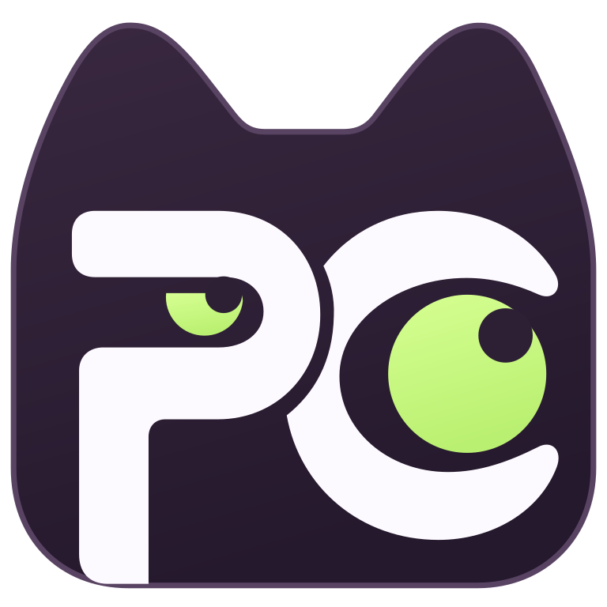
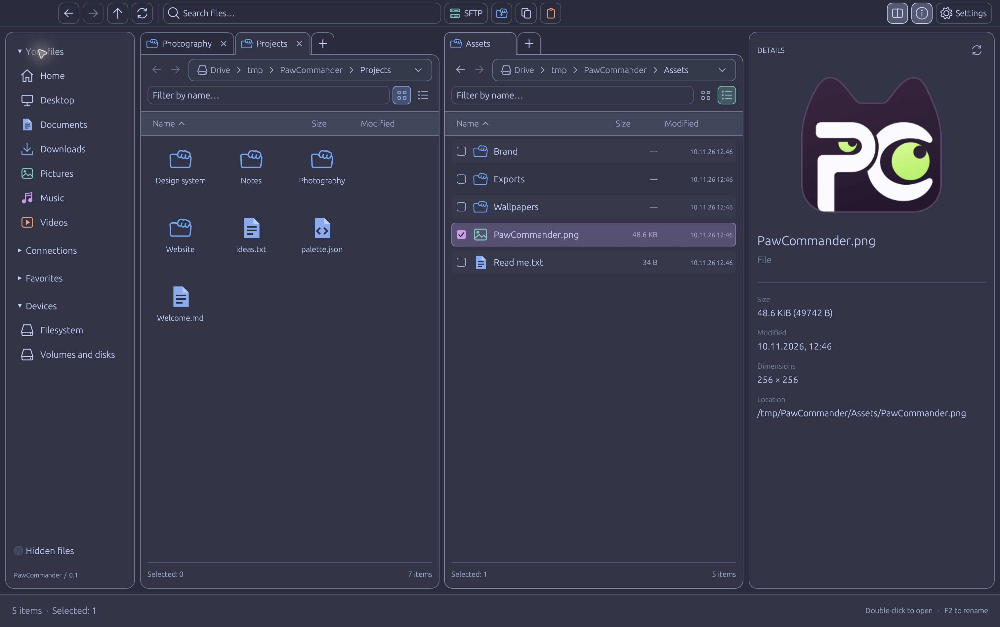

<div align="center">



# PawCommander

### Two panes. Your files. A little more flow.

A desktop file manager for people who like their workspace organized.<br>
Built with Rust, with local files and SFTP side by side.

[](https://github.com/starPaw/pawcommander/actions/workflows/ci.yml)
[](LICENSE)
[](https://www.rust-lang.org/)
[](https://github.com/catppuccin/catppuccin)

[Website](https://pawcommander.capture402.xyz/) · [Download for Mac](https://github.com/starPaw/pawcommander/releases/download/v0.1.0/PawCommander-0.1.0-macOS-arm64.zip) · [User guide](docs/USER_GUIDE.md) · [Report a bug](https://github.com/starPaw/pawcommander/issues/new/choose) · [Contribute](CONTRIBUTING.md)

</div>

---

PawCommander brings a familiar two-pane workflow to a calm, colorful desktop app. Keep a project on one side and its destination on the other. Browse with tabs, preview a file, connect to a server, and get on with your work.



<p align="center"><sub>Catppuccin Frappé · Grid and list views · Image preview · Demonstration files</sub></p>

## Make room for your files

| A comfortable workspace | Useful tools, close at hand |
| --- | --- |
| **One pane or two.** Independent tabs, list and grid views, breadcrumbs, bookmarks, and folder history. | **Local files + SFTP.** Browse servers in either pane and copy files and folders between locations. |
| **See before you open.** Text and image previews, plus background size calculations for local files and folders. | **Find your way.** Filter the current folder or search local paths through `locate` / `plocate`. |
| **Move naturally.** Multiple selection, file clipboard, drag and drop, and keyboard shortcuts. | **Keep track of transfers.** Background operations, copy progress, conflict choices, and free-space checks. |
| **Choose your mood.** All four Catppuccin palettes, system appearance, and English / Russian UI. | **Open in Zed.** Send local files or remote text files to your editor over SSH. |

Visible local folders refresh automatically. On macOS, you can also drag local files out to Finder and other apps.

## Get started

**PawCommander is an early release.** macOS is the primary development platform. Linux and Windows have platform-specific implementations and CI checks; desktop integration on those systems still needs broader testing. Feedback and reproducible bug reports are welcome.

### Download for Mac — no build tools needed

**[Download PawCommander 0.1.0 for Apple Silicon](https://github.com/starPaw/pawcommander/releases/download/v0.1.0/PawCommander-0.1.0-macOS-arm64.zip)**

1. Download and unzip the archive.
2. Drag **PawCommander.app** into **Applications**.
3. Open PawCommander.

The binary is built for **Apple Silicon (M-series), macOS 11 or later**, and tested on macOS 27.0.1. Older macOS releases have not been manually verified. Intel Macs, Windows, and Linux currently use the source build below.

This preview has an ad-hoc signature and is **not Apple-notarized or Developer ID signed**. If macOS blocks the first launch because the developer cannot be verified, follow [Apple's instructions](https://support.apple.com/en-us/102445): after attempting to open it, go to **System Settings → Privacy & Security → Open Anyway** if you trust the download. See the [installation guide](docs/MACOS_INSTALL.md) for checksums and details.

### Build from source

Build from source using [Rust and Cargo](https://www.rust-lang.org/tools/install). The repository pins Rust **1.90.0** and its dependencies.

### 1. Install build prerequisites

<details>
<summary><strong>macOS</strong></summary>

Install Apple's command-line developer tools:

```sh
xcode-select --install
```

</details>

<details>
<summary><strong>Ubuntu / Debian</strong></summary>

```sh
sudo apt-get update
sudo apt-get install -y build-essential pkg-config perl \
  libx11-dev libxcb-render0-dev libxcb-shape0-dev libxcb-xfixes0-dev \
  libxkbcommon-dev libxkbcommon-x11-dev libwayland-dev \
  libegl1-mesa-dev libgl1-mesa-dev libssl-dev
```

A graphical desktop with OpenGL is required. Saving SFTP keys also requires a running Secret Service session.

</details>

<details>
<summary><strong>Windows</strong></summary>

Install Rust with the MSVC toolchain, Visual Studio Build Tools with **Desktop development with C++**, and Perl available in `PATH` for the bundled OpenSSL build.

</details>

### 2. Build and run

```sh
git clone https://github.com/starPaw/pawcommander.git
cd pawcommander
cargo run --release --locked
```

To open a specific folder, pass it as the first argument:

```sh
cargo run --release --locked -- "/path/to/folder"
```

### 3. Make a macOS app

```sh
bash scripts/build-macos.sh
open dist/PawCommander.app
```

Drag `dist/PawCommander.app` into Applications if you want to keep it there. The bundle is built for your Mac's architecture and uses a local ad-hoc signature. It is **not Apple-notarized or Developer ID signed**.

## A few shortcuts to settle in

`Cmd/Ctrl` means Command on macOS and Control on Linux / Windows. Some Mac keyboards also require `Fn` for function keys.

| Action | Shortcut |
| --- | --- |
| Show / hide the second pane | `F3` |
| New / close tab | `Cmd/Ctrl+T` / `Cmd/Ctrl+W` |
| Enter a path | `Cmd/Ctrl+L` |
| Filter this folder | `Cmd/Ctrl+F` |
| Search local paths | `Cmd/Ctrl+Shift+F` |
| Copy / cut / paste | `Cmd/Ctrl+C` / `X` / `V` |
| Create a folder | `Cmd/Ctrl+Shift+N` |
| Rename | `F2` |
| Local file properties | `Alt+Enter` |
| Refresh | `F5` |

See the [user guide](docs/USER_GUIDE.md) for SFTP setup, clipboard behavior, drag and drop, previews, and all shortcuts.

## Know the edges

- **Transfers are not backups.** Local copying does not preserve every OS-specific attribute, ACL, Finder tag, or hard-link relationship. SFTP copying supports regular files and folders, with more limited metadata preservation.
- **Remote deletion is permanent.** Local deletion uses the system trash; SFTP deletion requires a separate permanent-delete confirmation.
- **Search uses an external index.** `locate` results can be stale. This is path search, not file-content search or SFTP search.
- **SFTP is deliberately explicit.** Verify server keys with OpenSSH first. ProxyJump, interactive MFA, and SSH-config-based connection setup are not supported. Transfers require server free-space reporting.
- **Some features are still ahead.** No built-in terminal, archive browsing, transfer resume, or network protocols beyond SFTP.

Details about transfer recovery and platform differences live in the [user guide](docs/USER_GUIDE.md).

## Help shape PawCommander

Try it on your everyday folders, tell us where the workflow feels rough, or help test a platform. Small, focused contributions are welcome: fixes, documentation, translations, and clear bug reports all help.

Read [CONTRIBUTING.md](CONTRIBUTING.md) to build and check a change. For sensitive reports, use [SECURITY.md](SECURITY.md).

## Built with good company

[Rust](https://www.rust-lang.org/) · [egui / eframe](https://github.com/emilk/egui) · [Catppuccin](https://github.com/catppuccin/catppuccin) · [ssh2-rs](https://github.com/alexcrichton/ssh2-rs)

Inspired by the two-pane workflows of classic file managers and KDE Dolphin. PawCommander is an independent project.

**[MIT licensed](LICENSE).** Free to use, modify, and share.
