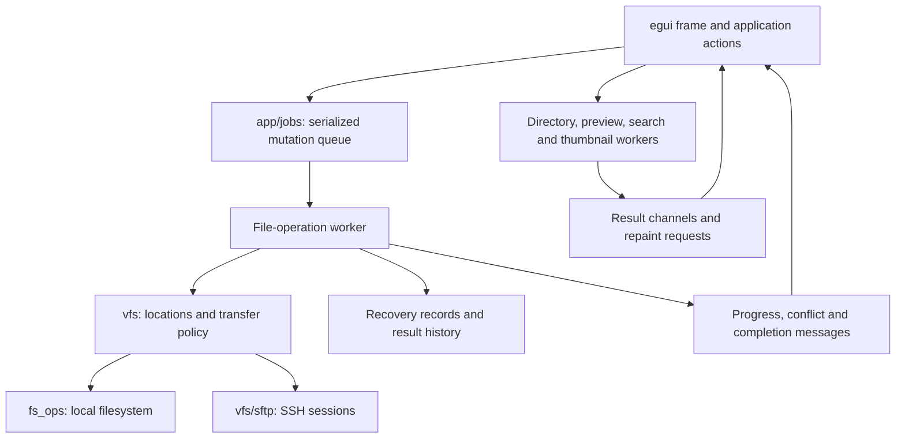

# Architecture and source map

PawCommander is a single Rust binary using eframe/egui. Start at the module that owns the behavior; `app.rs` coordinates the frame lifecycle, while its submodules own individual features. Build and submission checks are in [CONTRIBUTING.md](../CONTRIBUTING.md).

## Find the owner

| Change | Start here | Related code |
| --- | --- | --- |
| Startup, window, frame lifecycle | [`main.rs`](../src/main.rs), [`app.rs`](../src/app.rs) | [`app/persistence.rs`](../src/app/persistence.rs) initializes and saves state |
| macOS command-line launch | [`cli.rs`](../src/cli.rs) | Commands validate their operands before opening a window. Explicit launches use a temporary copy of the saved profile. |
| Actions, keyboard, focus | [`app/actions.rs`](../src/app/actions.rs), [`app/keyboard.rs`](../src/app/keyboard.rs) | [`shortcuts.rs`](../src/shortcuts.rs), [`command_palette.rs`](../src/command_palette.rs) |
| Panes, tabs, navigation, directory loading | [`app/tabs.rs`](../src/app/tabs.rs), [`app/directory.rs`](../src/app/directory.rs) | `app/pane_view.rs`, `app/column_view.rs`, `app/address_bar.rs`, `address.rs`, `directory_tree.rs` |
| Git status on macOS | [`app/git_status.rs`](../src/app/git_status.rs) | Each visible pane schedules local, read-only libgit2 scans. Branch names and entry badges use snapshots of the current folder. |
| Selection, rows, drag targets | [`app/selection.rs`](../src/app/selection.rs), [`app/entry_widget.rs`](../src/app/entry_widget.rs) | `drag_drop.rs`, `tab_drag.rs`, `app/tab_strip.rs` |
| Settings, workspaces, bookmarks | [`app/state.rs`](../src/app/state.rs), [`app/persistence.rs`](../src/app/persistence.rs) | `app/bookmarks.rs`, `app/sidebar.rs` |
| Mutation queue, progress, conflict UI | [`app/jobs.rs`](../src/app/jobs.rs), [`operations.rs`](../src/operations.rs) | `conflict.rs`, `app/footer.rs`, `app/dialogs.rs` |
| Local/SFTP transfer policy | [`vfs/transfer.rs`](../src/vfs/transfer.rs) | [`fs_ops.rs`](../src/fs_ops.rs) for local I/O primitives; `vfs/mutations.rs` for mkdir, rename and deletion |
| Moves across local volumes or connections | [`vfs/cross_move.rs`](../src/vfs/cross_move.rs) | Mandatory copy verification, guarded source removal and partial results; published copies are excluded from Retry and rename-only Undo |
| Retry unfinished transfers | [`vfs/retry.rs`](../src/vfs/retry.rs) | `app/jobs.rs` owns session retry requests; `result_history.rs` presents actions without replaying stored display paths |
| Resume interrupted transfers on macOS | [`vfs/resume_copy.rs`](../src/vfs/resume_copy.rs), [`vfs/resume_copy/tree.rs`](../src/vfs/resume_copy/tree.rs) | A locked receipt records the source, destination and private staging directory. [`recovery.rs`](../src/recovery.rs) lists available receipts. For copy-based moves, the queue records the verified copy's identity before publication and checks it again before guarded source removal. |
| Undo renames and moves | [`vfs/undo.rs`](../src/vfs/undo.rs) | Typed session receipts capture parents and moved entries; `app/jobs.rs` serializes inverse renames and owns remaining work, `result_history.rs` exposes eligible actions |
| Location parsing, listing, SSH sessions | [`vfs/location.rs`](../src/vfs/location.rs), [`vfs/listing.rs`](../src/vfs/listing.rs), [`vfs/sftp.rs`](../src/vfs/sftp.rs) | `credentials.rs`, `app/dialogs.rs` |
| SMB connections on macOS | [`smb.rs`](../src/smb.rs), [`app/smb_connections.rs`](../src/app/smb_connections.rs) | `smb/macos.m` mounts shares through NetFS. The connection worker uses Keychain for optional password storage. |
| SFTP permissions | [`vfs/permissions.rs`](../src/vfs/permissions.rs), [`app/permissions.rs`](../src/app/permissions.rs) | An independent reader previews proposed modes. The mutation worker checks the previewed metadata and records each result. |
| Copy/cut/paste | [`app/clipboard.rs`](../src/app/clipboard.rs), [`file_clipboard.rs`](../src/file_clipboard.rs) | `file_clipboard/{macos,windows,linux}.rs` |
| Preview, Quick Look, thumbnails | [`preview.rs`](../src/preview.rs), [`app/quick_look.rs`](../src/app/quick_look.rs) | `preview/code.rs`, `preview/markup.rs`, `thumbnails.rs`, `vfs/preview.rs` |
| PDF preview on macOS | [`preview/pdf.rs`](../src/preview/pdf.rs), [`preview/pdf/view.rs`](../src/preview/pdf/view.rs) | `preview/pdf/protocol.rs`, `preview/pdf/worker.rs`, `preview/pdf/macos.m` |
| Audio and video preview on macOS | [`preview/media.rs`](../src/preview/media.rs), [`preview/media/view.rs`](../src/preview/media/view.rs) | `preview/media/session.rs`, `preview/media/worker.rs`, `preview/media/macos.m`, `vfs/preview.rs` |
| Image and media metadata on macOS | [`preview/metadata.rs`](../src/preview/metadata.rs), [`preview/media/macos.m`](../src/preview/media/macos.m) | ImageIO reads EXIF from the bounded image bytes. The AVFoundation helper sends track metadata once when ready |
| CSV and TSV preview | [`preview/table.rs`](../src/preview/table.rs), [`preview/table/view.rs`](../src/preview/table/view.rs) | `preview/table/records.rs`, `preview/table/worker.rs`, `vfs/preview.rs` |
| Large text preview | [`preview/large_text.rs`](../src/preview/large_text.rs), [`preview/large_text/view.rs`](../src/preview/large_text/view.rs) | `preview/large_text/reader.rs`, `preview/large_text/worker.rs`, `preview/source.rs` |
| Hex preview | [`preview/hex.rs`](../src/preview/hex.rs), [`preview/hex/view.rs`](../src/preview/hex/view.rs) | `preview/hex/worker.rs`, `preview/source.rs`, `preview/read_worker.rs` |
| Preview encoding | [`preview/encoding.rs`](../src/preview/encoding.rs) | Text and table workers share encoding selection and decoding |
| Search and result actions | [`search.rs`](../src/search.rs), [`search/panel.rs`](../src/search/panel.rs), [`app/search.rs`](../src/app/search.rs) | `search/{content,directory,filters,index,remote,saved}.rs`, `name_match.rs` |
| Bounded SFTP search walk | [`vfs/search.rs`](../src/vfs/search.rs) | One directory handle on an existing session. Limits depth, entries and pending path bytes, and checks the deadline and cancellation between requests. |
| Open Terminal in a folder on macOS | [`terminal/macos.rs`](../src/terminal/macos.rs), [`app/address_bar.rs`](../src/app/address_bar.rs) | An application launch worker passes the local folder or a private SSH launch document to Apple Terminal. OpenSSH owns the new session. |
| Embedded terminal on macOS | [`terminal/embedded.rs`](../src/terminal/embedded.rs), [`terminal/pty.rs`](../src/terminal/pty.rs) | A worker owns the PTY and shell lifecycle. `terminal/embedded/session.rs` parses output with Alacritty and handles input and resize. The UI snapshots the visible grid before painting and routes keyboard input by focus. |
| Custom actions on macOS | [`app/custom_actions.rs`](../src/app/custom_actions.rs), [`tools/custom_action.rs`](../src/tools/custom_action.rs) | The preview owns the working folder and resolved argument list. A background worker starts the configured executable with those same values. |
| External editors on macOS | [`app/external_editors.rs`](../src/app/external_editors.rs), [`vfs/external_editor.rs`](../src/vfs/external_editor.rs) | The queue prepares private working copies and checks the recorded SFTP revision before publishing edits. It also checks the previous file after moving it to staging. |
| ZIP/TAR browsing | [`archive.rs`](../src/archive.rs) | `vfs/location.rs`, `app/tabs.rs` |
| ZIP/TAR creation | [`archive/writer.rs`](../src/archive/writer.rs), [`vfs/archive_create.rs`](../src/vfs/archive_create.rs) | `app/dialogs.rs`, `operations.rs` |
| ZIP/TAR extraction | [`archive/extraction.rs`](../src/archive/extraction.rs), [`vfs/archive_extract.rs`](../src/vfs/archive_extract.rs) | `app/jobs.rs`, `vfs/staged_file.rs`, `conflict.rs` |
| ZIP/TAR editing | [`archive/edit.rs`](../src/archive/edit.rs), [`vfs/archive_edit.rs`](../src/vfs/archive_edit.rs) | `app/dialogs.rs`, `vfs/archive_create.rs`, `vfs/transfer.rs` |
| SHA-256 checksum manifests | [`vfs/checksum.rs`](../src/vfs/checksum.rs), [`vfs/checksum/manifest.rs`](../src/vfs/checksum/manifest.rs) | Job queue and result history, streaming SHA-256 reader, staged publication without replacement |
| Folder comparison | [`app/directory_compare.rs`](../src/app/directory_compare.rs), [`vfs/compare.rs`](../src/vfs/compare.rs) | Paired listings skip unreadable branches. Bounded content reads share [`vfs/read_scope.rs`](../src/vfs/read_scope.rs) with checksum manifests |
| File comparison | [`app/file_compare.rs`](../src/app/file_compare.rs), [`vfs/file_compare.rs`](../src/vfs/file_compare.rs) | Shared comparison worker and guarded reads. Bounded line diff and literal external tool arguments |
| Password-protected ZIP | [`archive/protected_zip.rs`](../src/archive/protected_zip.rs), [`archive/writer.rs`](../src/archive/writer.rs) | `app/dialogs.rs`, `vfs/staged_file.rs` |
| Recovery and operation history | [`recovery.rs`](../src/recovery.rs), [`result_history.rs`](../src/result_history.rs) | `app/jobs.rs` |
| Native integrations and file properties | [`native_drag.rs`](../src/native_drag.rs), [`properties.rs`](../src/properties.rs) | `native_drag/{macos,desktop,windows,linux}.rs`, `native_drag/linux/`, `properties/{unix,windows}.rs`, `macos_about.rs`, `tools.rs`, `zed.rs` |
| UI text, colors and icons | [`i18n.rs`](../src/i18n.rs), [`theme.rs`](../src/theme.rs), [`icons.rs`](../src/icons.rs) | The [text](../src/i18n/catalog.rs) and [format](../src/i18n/formats.rs) catalogs keep translations together |

Some application modules import `vfs as fs_ops`. Follow that alias when tracing calls: it is the VFS facade, not the local-only `src/fs_ops.rs` module.

## Runtime boundaries

The main thread owns application state. `App::logic` polls worker channels and advances the mutation queue even when the window is hidden; `App::ui` renders widgets. Mutation jobs capture their inputs when queued; one active job serializes filesystem changes, including changes to overlapping paths. Pending jobs do not perform filesystem work before dispatch. Do not add direct filesystem or network work to widget rendering or bypass the mutation queue for a new write action.

Directory reads use bounded channels and progressive batches. Dropping a directory load cancels it and disconnects its producer. Previews coalesce pending requests and use generations to reject stale results. Search and thumbnails have their own worker lifecycles. Preserve cancellation, stale-result protection and repaint notifications when extending these paths.

NetFS mounts SMB shares on demand in a private directory for each connection. The empty directory underneath the share is write-protected so an old tab cannot send data to a local folder after the mount disappears. The file queue uses normal mounted paths for browsing and downloads. SMB uploads create regular files exclusively through an open SMB directory handle because macOS SMB volumes lack exclusive rename. A failure after creation records the result as unconfirmed and leaves the new name for inspection.

The macOS PDF preview passes a bounded byte snapshot to a helper process. Its native renderer uses PDFKit for document text and selections and Core Graphics for page rasters. The preview worker owns the helper, enforces response sizes and deadlines, and ends the session when the preview changes. The UI uploads only the current page texture.

Quick Look starts an AVFoundation player in a helper process and polls its clock and video output from a background thread. The interface consumes only the latest state and frame. Local files play from disk and SFTP files use a bounded temporary copy. Clearing the preview cancels the controller and reaps the helper before discarding its temporary file. PDF and media share the bounded, cancellable helper transport in [`preview/helper.rs`](../src/preview/helper.rs).

Quick Look parses CSV and TSV from a bounded input buffer on a worker thread and publishes batches into one page. Page navigation seeks by logical record offsets in the opened local or SFTP file. It verifies the source metadata before reusing an offset. A new filter or separator cancels the current request and scans from the beginning. Closing the preview drops the worker request and releases the input.

Large text Quick Look reads one page near a 32 KiB boundary at a time. The worker aligns boundaries to nearby line endings or complete characters and tracks original line numbers while seeking. Literal search uses 64 KiB buffers with enough overlap for matches that cross read boundaries. Only the displayed page and current match are retained. The text and table previews share the seekable local/SFTP source and check its metadata before using saved offsets.

The selected encoding is fixed for each preview generation. Large text workers search in the source encoding and map match locations to the decoded page. Table workers decode in bounded chunks and count source bytes when recording the next page offset. Changing the encoding discards the previous generation and starts the read again.

Hex mode reads aligned 4 KiB pages through the shared seekable source. Literal byte search shares the bounded block reader and cancellation used by large text. A match near the end of a page includes just enough bytes from the next page to display the full match. Leaving hex mode drops the reader request.

## Trace a transfer

1. An action or clipboard request calls `PawCommander::start_transfer` in `app/jobs.rs`, capturing sources, destination, cut generation and copy-verification settings.
2. The job queue starts a worker and writes a recovery record before mutation. `vfs::transfer_with_conflicts` validates and plans the transfer against current filesystem state.
3. Conflicts travel to the UI through a channel. The worker waits for a reply while observing cancellation; `conflict.rs` owns the choices and dialog.
4. Local copies use `fs_ops.rs`; remote copies use the SFTP transfer path. Staging, source/destination checks and publication logic protect existing data. Replacement and cleanup errors must remain visible in the result.
5. Progress and committed move events return to the UI. Cut entries are consumed only for confirmed moves of the matching clipboard generation. The worker records results, completes the recovery record when appropriate, and the UI refreshes affected views.

The copy and move worker acknowledges a pause at checkpoints in preparation, between I/O calls, and before final publication. It keeps the transfer plan, private staging, and stream positions while waiting on a condition variable. Resume and cancellation wake the worker. Publication, rollback, and cleanup proceed without pausing.

The active copy route selects the lowest nonzero transfer limit for its endpoints. The worker paces payload blocks and remote verification reads with a bounded credit balance. Changing a limit wakes the same condition variable used by Pause and Stop. A new route picks up the latest settings when its staged copy begins.

`Location` represents local, SFTP and archive paths. Archive locations support browsing and explicit extraction into a local or SFTP folder. Extraction validates the bounded archive index, streams regular files into private staging and publishes each selected root through the existing conflict and publication flow. The archive integrity worker checks local ZIP and TAR files, consumes entry data without publishing files, and records entry diagnostics in result history. Copies can cross local/SFTP boundaries; moves between local and SFTP or between different SFTP backends are rejected. Saved locations contain connection coordinates and key paths; secrets belong in credential storage and authenticated sessions, not serialized settings.

The SFTP form can resolve an alias with [`ssh_config.rs`](../src/ssh_config.rs) on a background worker. The importer reads a bounded user configuration file and reports unsupported directives without evaluating command or conditional blocks. The connection uses the reviewed endpoint fields and the existing known-host verification and authentication flow.

The SFTP connection worker checks OpenSSH records and PawCommander's host-and-port fingerprints before negotiating authentication. An unknown key in the SFTP dialog requires explicit approval. The worker rechecks both sources and publishes the fingerprint in the local application-data directory with a non-replacing file operation. Background connections require an existing trust record.

Host-key confirmation and keyboard-interactive rounds travel to the active connection dialog through a channel. The worker waits for each reply with a deadline and uses a separate TCP handle to abort a cancelled or expired attempt. It releases the shutdown handle before publishing the session to the shared cache.

A foreground operation can replace a disconnected cached SSH session before opening its SFTP channel. Connections to one endpoint share a reconnect gate. Background folder polling only opens channels on existing sessions. Requests issued on a channel and its open file handles remain tied to that connection.

The in-session transfer retry plan tracks the actual destination, its prior metadata, and any staging or held-source paths. For an unconfirmed SFTP publication, a read-only job checks those locations and records the observed state in result history. It offers a retry only for objects that pass the source and destination checks. The retry worker validates the evidence again before writing.

SFTP transfers set attributes on the private copy after content verification and apply directory metadata after their children. The worker checks the resulting fields and records any partial preservation as result warnings. A copy-and-delete move reapplies access times after its final readback and retains owner read and traversal rights until that verification is complete.

Password-protected ZIP creation streams AES-256 to the same private staging file used for plain archives. Encrypted extraction matches the decoder's entry offsets and sizes against the bounded index and reads through EOF before publishing. The dialog passes the password directly to its queued work. The operation description, result history and recovery record use file locations and outcomes.

Archive edits run through the file-operation queue. They check the resulting member paths, reuse the archive creation path for additions, and preserve retained ZIP payloads or intact TAR record ranges. The worker closes and validates the staged archive before handing it to the checked replacement and rollback flow.

OS adapters are selected with `cfg`: file clipboard and native drag-out implementations cover macOS, Windows and Linux. Native drag-out keeps egui's internal targets until the pointer reaches the window boundary, then offers files with copy permission. On macOS, an AppKit file promise for an SFTP item submits a download to the existing file queue when the receiver requests it. The copy uses the receiver's exact path and checks and publishes through private staging. Windows uses OLE file-drop data; Linux uses a separate XDND worker for X11 or a private Wayland event queue on the existing display, observing the actual pointer-press serial. Linux protocol handling and data-pipe writes run outside the UI thread. Shared tests cannot establish native clipboard, drag, accessibility or window behavior on another OS.

## Focused verification

Tests live beside their modules, with larger suites under `src/app/tests/` and `src/vfs/tests/`. There is no separate integration-test crate. Run a relevant filter while iterating, then the complete checks from [CONTRIBUTING.md](../CONTRIBUTING.md) before submission.

| Area | Useful starting command |
| --- | --- |
| Queue, conflicts, cut ownership, operation UI | `cargo test --locked app::tests::jobs` |
| Navigation, focus, session state | `cargo test --locked app::tests` |
| Transfer conflicts and cancellation | `cargo test --locked vfs::tests` |
| Local filesystem safety | `cargo test --locked fs_ops::tests` |
| Preview parsing and interaction | `cargo test --locked preview::` |
| Search traversal and result validation | `cargo test --locked search::` |
| Recovery and result records | `cargo test --locked recovery::` and `cargo test --locked result_history::` |
| Real SFTP and host verification | `bash scripts/test-sftp.sh` |

The SFTP script runs an ignored test against a disposable loopback OpenSSH server. Also run it with `PAWCOMMANDER_TEST_DISABLE_STATVFS=1` when changing remote capacity checks. The OS credential-store test is separately opt-in; see the contribution guide. Use disposable files and isolated app state for native acceptance, and record which operating systems were actually exercised.

## Keep changes easy to navigate

Search the owning directory first, for example `rg 'start_transfer|transfer_with_conflicts' src/app src/vfs`, and find nearby regressions with `rg '#\[test\]|fn .*cancel' src/vfs/tests`. The map identifies stable boundaries; source code remains authoritative as they evolve.

Keep each change bounded to its owning modules and tests. Give parallel contributors disjoint files or independent review tasks; a shared file needs one primary writer. Record reproducible check commands and relevant results so the next contributor can continue without reconstructing the entire investigation. Measure build time, test time and task outcomes before changing caches, test selection or development tooling for speed.
