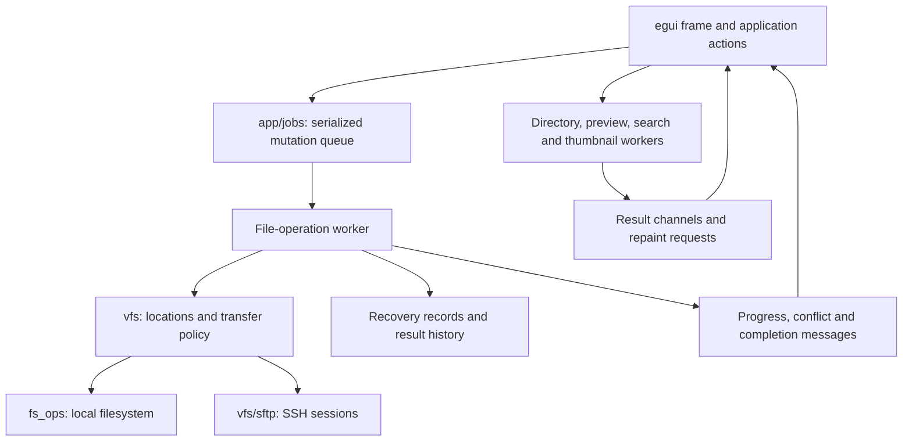

# Architecture and source map

PawCommander is a single Rust binary using eframe/egui. Start at the module that owns the behavior; `app.rs` coordinates the frame lifecycle, while its submodules own individual features. Build and submission checks are in [CONTRIBUTING.md](../CONTRIBUTING.md).

## Find the owner

| Change | Start here | Related code |
| --- | --- | --- |
| Startup, window, frame lifecycle | [`main.rs`](../src/main.rs), [`app.rs`](../src/app.rs) | [`app/persistence.rs`](../src/app/persistence.rs) initializes and saves state |
| Actions, keyboard, focus | [`app/actions.rs`](../src/app/actions.rs), [`app/keyboard.rs`](../src/app/keyboard.rs) | [`shortcuts.rs`](../src/shortcuts.rs), [`command_palette.rs`](../src/command_palette.rs) |
| Panes, tabs, navigation, directory loading | [`app/tabs.rs`](../src/app/tabs.rs), [`app/directory.rs`](../src/app/directory.rs) | `app/pane_view.rs`, `app/column_view.rs`, `app/address_bar.rs`, `address.rs`, `directory_tree.rs` |
| Selection, rows, drag targets | [`app/selection.rs`](../src/app/selection.rs), [`app/entry_widget.rs`](../src/app/entry_widget.rs) | `drag_drop.rs`, `tab_drag.rs`, `app/tab_strip.rs` |
| Settings, workspaces, bookmarks | [`app/state.rs`](../src/app/state.rs), [`app/persistence.rs`](../src/app/persistence.rs) | `app/bookmarks.rs`, `app/sidebar.rs` |
| Mutation queue, progress, conflict UI | [`app/jobs.rs`](../src/app/jobs.rs), [`operations.rs`](../src/operations.rs) | `conflict.rs`, `app/footer.rs`, `app/dialogs.rs` |
| Local/SFTP transfer policy | [`vfs/transfer.rs`](../src/vfs/transfer.rs) | [`fs_ops.rs`](../src/fs_ops.rs) for local I/O primitives; `vfs/mutations.rs` for mkdir, rename and deletion |
| Moves across local volumes or connections | [`vfs/cross_move.rs`](../src/vfs/cross_move.rs) | Mandatory copy verification, guarded source removal and partial results; published copies are excluded from Retry and rename-only Undo |
| Retry unfinished transfers | [`vfs/retry.rs`](../src/vfs/retry.rs) | `app/jobs.rs` owns session retry requests; `result_history.rs` presents actions without replaying stored display paths |
| Undo renames and moves | [`vfs/undo.rs`](../src/vfs/undo.rs) | Typed session receipts capture parents and moved entries; `app/jobs.rs` serializes inverse renames and owns remaining work, `result_history.rs` exposes eligible actions |
| Location parsing, listing, SSH sessions | [`vfs/location.rs`](../src/vfs/location.rs), [`vfs/listing.rs`](../src/vfs/listing.rs), [`vfs/sftp.rs`](../src/vfs/sftp.rs) | `credentials.rs`, `app/dialogs.rs` |
| Copy/cut/paste | [`app/clipboard.rs`](../src/app/clipboard.rs), [`file_clipboard.rs`](../src/file_clipboard.rs) | `file_clipboard/{macos,windows,linux}.rs` |
| Preview, Quick Look, thumbnails | [`preview.rs`](../src/preview.rs), [`app/quick_look.rs`](../src/app/quick_look.rs) | `preview/code.rs`, `preview/markup.rs`, `thumbnails.rs`, `vfs/preview.rs` |
| Search and result actions | [`search.rs`](../src/search.rs), [`search/panel.rs`](../src/search/panel.rs), [`app/search.rs`](../src/app/search.rs) | `search/{content,directory,filters,index,saved}.rs`, `name_match.rs` |
| Read-only ZIP/TAR browsing | [`archive.rs`](../src/archive.rs) | `vfs/location.rs`, `app/tabs.rs` |
| ZIP/TAR creation | [`archive/writer.rs`](../src/archive/writer.rs), [`vfs/archive_create.rs`](../src/vfs/archive_create.rs) | `app/dialogs.rs`, `operations.rs` |
| ZIP/TAR extraction | [`archive/extraction.rs`](../src/archive/extraction.rs), [`vfs/archive_extract.rs`](../src/vfs/archive_extract.rs) | `app/jobs.rs`, `vfs/staged_file.rs`, `conflict.rs` |
| Password-protected ZIP | [`archive/protected_zip.rs`](../src/archive/protected_zip.rs), [`archive/writer.rs`](../src/archive/writer.rs) | `app/dialogs.rs`, `vfs/staged_file.rs` |
| Recovery and operation history | [`recovery.rs`](../src/recovery.rs), [`result_history.rs`](../src/result_history.rs) | `app/jobs.rs` |
| Native integrations and file properties | [`native_drag.rs`](../src/native_drag.rs), [`properties.rs`](../src/properties.rs) | `native_drag/{macos,desktop,windows,linux}.rs`, `native_drag/linux/`, `properties/{unix,windows}.rs`, `macos_about.rs`, `tools.rs`, `zed.rs` |
| UI text, colors and icons | [`i18n.rs`](../src/i18n.rs), [`theme.rs`](../src/theme.rs), [`icons.rs`](../src/icons.rs) | Keep English and Russian text synchronized |

Some application modules import `vfs as fs_ops`. Follow that alias when tracing calls: it is the VFS facade, not the local-only `src/fs_ops.rs` module.

## Runtime boundaries

The main thread owns application state. `App::logic` polls worker channels and advances the mutation queue even when the window is hidden; `App::ui` renders widgets. Mutation jobs capture their inputs when queued; one active job serializes filesystem changes, including changes to overlapping paths. Pending jobs do not perform filesystem work before dispatch. Do not add direct filesystem or network work to widget rendering or bypass the mutation queue for a new write action.

Directory reads use bounded channels and progressive batches. Dropping a directory load cancels it and disconnects its producer. Previews coalesce pending requests and use generations to reject stale results. Search and thumbnails have their own worker lifecycles. Preserve cancellation, stale-result protection and repaint notifications when extending these paths.

## Trace a transfer

1. An action or clipboard request calls `PawCommander::start_transfer` in `app/jobs.rs`, capturing sources, destination, cut generation and copy-verification settings.
2. The job queue starts a worker and writes a recovery record before mutation. `vfs::transfer_with_conflicts` validates and plans the transfer against current filesystem state.
3. Conflicts travel to the UI through a channel. The worker waits for a reply while observing cancellation; `conflict.rs` owns the choices and dialog.
4. Local copies use `fs_ops.rs`; remote copies use the SFTP transfer path. Staging, source/destination checks and publication logic protect existing data. Replacement and cleanup errors must remain visible in the result.
5. Progress and committed move events return to the UI. Cut entries are consumed only for confirmed moves of the matching clipboard generation. The worker records results, completes the recovery record when appropriate, and the UI refreshes affected views.

`Location` represents local, SFTP and archive paths. Archive locations support browsing and explicit extraction into a local or SFTP folder. Extraction validates the bounded archive index, streams regular files into private staging and publishes each selected root through the existing conflict and publication flow. The archive integrity worker checks local ZIP and TAR files, consumes entry data without publishing files, and records entry diagnostics in result history. Copies can cross local/SFTP boundaries; moves between local and SFTP or between different SFTP backends are rejected. Saved locations contain connection coordinates and key paths; secrets belong in credential storage and authenticated sessions, not serialized settings.

Password-protected ZIP creation streams AES-256 to the same private staging file used for plain archives. Encrypted extraction matches the decoder's entry offsets and sizes against the bounded index and reads through EOF before publishing. The dialog passes the password directly to its queued work. The operation description, result history and recovery record use file locations and outcomes.

OS adapters are selected with `cfg`: file clipboard and native drag-out implementations cover macOS, Windows and Linux. Native drag-out keeps egui's internal targets until the pointer reaches the window boundary, then exports local files with copy permission. Windows uses OLE file-drop data; Linux uses a separate XDND worker for X11 or a private Wayland event queue on the existing display, observing the actual pointer-press serial. Linux protocol handling and data-pipe writes run outside the UI thread. The drag source never removes files; the receiver owns conflicts and transfer progress. Shared tests cannot establish native clipboard, drag, accessibility or window behavior on another OS.

## Focused verification

Tests live beside their modules, with larger suites under `src/app/tests/` and `src/vfs/tests/`. There is no separate integration-test crate. Run a relevant filter while iterating, then the complete checks from [CONTRIBUTING.md](../CONTRIBUTING.md) before submission.

| Area | Useful starting command |
| --- | --- |
| Queue, conflicts, cut ownership, operation UI | `cargo test --locked app::tests::jobs` |
| Navigation, focus, session state | `cargo test --locked app::tests` |
| Transfer conflicts and cancellation | `cargo test --locked vfs::tests` |
| Local filesystem safety | `cargo test --locked fs_ops::tests` |
| Preview parsing and interaction | `cargo test --locked preview::` |
| Search traversal and result validation | `cargo test --locked search::` |
| Recovery and result records | `cargo test --locked recovery::` and `cargo test --locked result_history::` |
| Real SFTP and host verification | `bash scripts/test-sftp.sh` |

The SFTP script runs an ignored test against a disposable loopback OpenSSH server. Also run it with `PAWCOMMANDER_TEST_DISABLE_STATVFS=1` when changing remote capacity checks. The OS credential-store test is separately opt-in; see the contribution guide. Use disposable files and isolated app state for native acceptance, and record which operating systems were actually exercised.

## Keep changes easy to navigate

Search the owning directory first, for example `rg 'start_transfer|transfer_with_conflicts' src/app src/vfs`, and find nearby regressions with `rg '#\[test\]|fn .*cancel' src/vfs/tests`. The map identifies stable boundaries; source code remains authoritative as they evolve.

Keep each change bounded to its owning modules and tests. Give parallel contributors disjoint files or independent review tasks; a shared file needs one primary writer. Record reproducible check commands and relevant results so the next contributor can continue without reconstructing the entire investigation. Measure build time, test time and task outcomes before changing caches, test selection or development tooling for speed.
